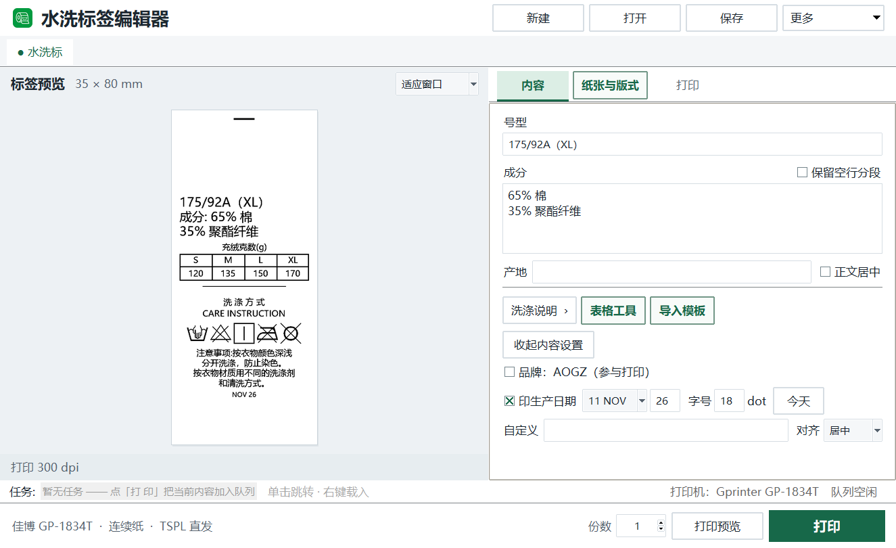

# 水洗标签编辑器

**By Yaoshi_Yellow**

用于编辑和打印服装水洗标签的 Windows 工具。可以在同一个窗口填写号型与成分、设置纸张、查看标签预览，再提交打印。



## Windows 版下载

在 [GitHub Releases](https://github.com/lib81996-glitch/water-label-editor/releases/tag/v1.12) 获取 `水洗标签编辑器-v1.12-便携分发版.zip`。软件适用于 **64 位 Windows 10 或 11**。完整解压到有写入权限的文件夹后，双击 `水洗标签编辑器.exe` 启动。

分发包内附带标准底版、示例标签、使用说明和 `运行环境检测.bat`。

## 快速上手

1. **打开标签。** 点击「打开」，选择随包提供的 `标准底版-35x75.wslabel` 或 `示例-6608.wslabel`。也可以用「新建」指定纸宽和纸长。
2. **填写内容。** 在「内容」页编辑号型、成分和产地。在「洗涤说明」里设置洗标图标和文字。需要填写充绒量时，用「表格工具」手动添加行，或勾选尺码自动生成。
3. **设置纸张。** 在「纸张与版式」填写实际纸宽和纸长。无缝卷料选「连续纸」。标签之间有物理间隙时，选「间隙纸」并填写实测间隙。
4. **选择打印机。** 先在 Windows 安装对应驱动，再到软件的「打印」页点「切换…」，选择本机的标签打印机。
5. **预览并打印。** 点击「打印预览」，确认内容、纸长和份数后，先试打一张核对走纸。可以点「保存」保留这份 `.wslabel` 模板。

## 常用功能

| 功能 | 入口与用途 |
| --- | --- |
| 表格工具 | 在「内容」页打开，按尺码生成表格，或手动添加三列、四列和五列的行。新行默认字号为 24 dot，可逐行调整。 |
| 导入模板 | 从 DLabel 模板提取号型、成分等可识别字段。导入后检查字段和预览，再保存为 `.wslabel`。 |
| 洗涤说明 | 设置洗涤图标的顺序、标题和注意事项。 |
| 批量打印与队列 | 从「打印」页进入，集中处理多个标签，查看任务状态。 |
| 自检页 | 用于试打并核对尺寸、偏移与走纸。 |

## 打印常见问题

- **连续纸两张之间为什么有空白？** 连续纸按设定纸长连续走纸。两张实际字迹之间的空白也受模板上方留白和尾部留白影响。先看多份打印预览，再核对纸长和留白。
- **切换打印机后，字号和位置会变吗？** 软件会为已识别的佳博 GP-1834T（300 dpi）和汉印 N31（203 dpi）按目标分辨率换算模板的字号与位置。预览底部会显示已识别的实际打印分辨率。
- **预览提示超长或超宽怎么办？** 检查纸张尺寸、字号、表格和留白，调整后再预览。需要随内容增加纸长时，可在「纸张与版式」勾选「内容超长时自动加长纸」。
- **程序启动不了或找不到打印机怎么办？** 在解压后的文件夹运行 `运行环境检测.bat`，按提示核对软件文件、运行库、打印机驱动和 Windows 打印服务。

## 问题反馈

在 Issues 里描述问题，并附上软件版本、Windows 版本、打印机型号、纸张类型和尺寸。遇到走纸或位置问题时，附上打印预览图和实物照片更容易定位。

## 从源码运行与构建

在 64 位 Windows 上用 Python 3.14（含 Tkinter）执行以下命令。依赖版本见 `requirements.txt`。

```powershell
python -m venv .venv
.\.venv\Scripts\python.exe -m pip install -r requirements.txt
.\.venv\Scripts\python.exe .\label_editor.pyw
```

用仓库根目录的 PyInstaller 配置构建便携版。

```powershell
.\.venv\Scripts\python.exe -m PyInstaller --noconfirm WaterLabel.spec
.\.venv\Scripts\python.exe .\scripts\package_release.py
```

EXE 和完整的便携 ZIP 都在 `dist/`。平时从 `label_editor.pyw` 启动界面，打印、版面渲染和模板保存逻辑在 `label_engine.py`。

## 许可

项目源码采用 [MIT 许可证](LICENSE)。便携版中打包的第三方运行时许可证附在分发包的 `第三方许可证` 文件夹。
